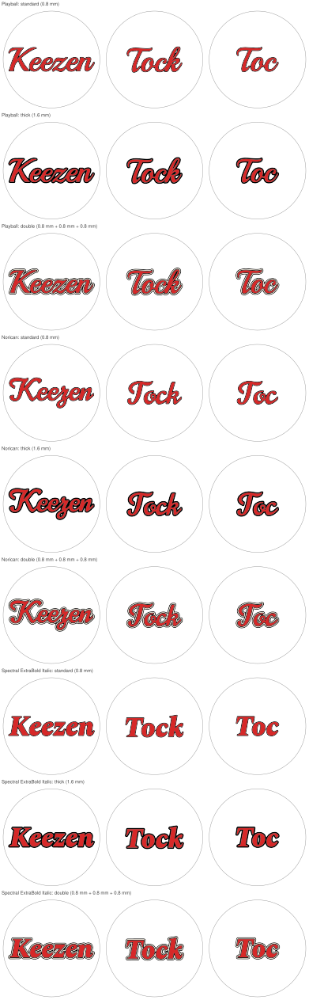
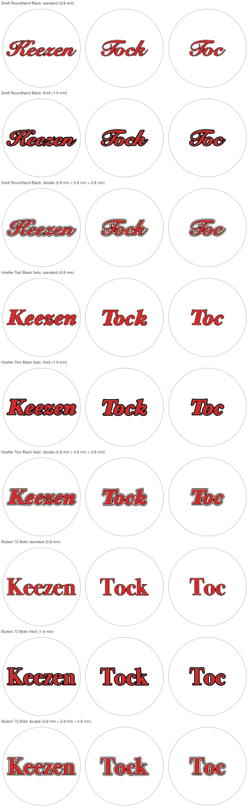
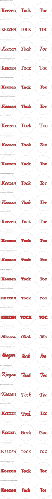

# Tock-Lid-Generator

A generator to create STLs for the lid of the Tock box.

It turns a word ("Keezen", "Tock", "Toc", …) into a round lid insert for multi-colour
printing: coloured letters, a black outline around every letter edge, and the rest of the disc.
Every colour comes out as its own STL (for the slicer) and its own SVG (for CAD), all sharing
one origin at the centre of the lid, so they fit together exactly.

## Fonts and styles

Every word is sized to the 122.4 mm lid; `tock-lid fonts` lists the font keys available on your
computer. Any other `.ttf`/`.otf` works too, with `--font-file`.

### Windows, macOS and Linux

Three free fonts ship with tock-lid, so they work on every system: **Playball**, **Norican** and
**Spectral ExtraBold Italic**, all under the [SIL Open Font License](src/tock_lid/fonts) (each
font's folder holds its `OFL.txt`). Shown in all three outline styles:



### macOS only

These are Apple system fonts, so tock-lid only offers them on a Mac. The favourites in all three
outline styles:



Every macOS font in the standard 0.8 mm outline:



### Windows only

None yet: the built-in Windows fonts are not part of the catalogue.

The images are generated on a Mac with `tock-lid docs`; run it after changing fonts or styles.
Elsewhere it only draws the images whose fonts that computer has.

## Download

Every font in all three styles (standard, thick, double) is available as ready-to-slice STLs
in one zip, attached to the
[latest release](https://github.com/AntondeGroot/Tock-Lid-Generator/releases/latest).
It is organised as `font/style/word/`, and each word folder has one STL per colour plus a preview.
STL files work on any computer, so you do not need the fonts to print these.

## Setup

Requires Python 3.11 or newer, on Windows, macOS or Linux.

macOS / Linux:

```sh
python3 -m venv .venv
source .venv/bin/activate
pip install -e ".[dev]"
```

Windows (PowerShell):

```powershell
py -m venv .venv
.venv\Scripts\Activate.ps1
pip install -e ".[dev]"
```

## Usage

With the virtual environment active, run the commands from the repository folder: output goes
to `out/` inside the folder you run them from, and each command prints the full path it wrote.

| Command | What it does |
|---|---|
| `tock-lid fonts` | list the fonts available on this computer |
| `tock-lid styles` | list the outline styles |
| `tock-lid generate --font playball --style double` | SVG and STL files per word and colour, in `out/` |
| `tock-lid overview --fonts playball norican --styles standard double` | one comparison sheet, `out/overview.svg` |
| `tock-lid docs` | regenerate the README images |
| `tock-lid bundle` | zip with the STLs of every available font in every style, `out/tock-lids.zip` |

Without `--font`, `generate` uses Snell Roundhand on a Mac and Playball elsewhere.

`generate` writes one folder per word into `out/`. Every file name starts with the word and the
font, cut at its first dash (`hoefler-black-italic` becomes `hoefler`); for example:

| File | What it is |
|---|---|
| `keezen-hoefler-preview.svg` | all colours together, with the lid edge dashed |
| `keezen-hoefler-fill.stl/.svg` | the letters |
| `keezen-hoefler-outline.stl/.svg` | the black outline (`outline-inner`, `gap`, `outline-outer` for `double`) |
| `keezen-hoefler-background.stl/.svg` | the rest of the disc |

In the slicer, load all STLs of one word at once and choose **one object with multiple parts**,
then give each part its filament.

Options shared by all commands that build lids:

| Option | Default | Meaning |
|---|---|---|
| `--words` | `Keezen Tock Toc` | one lid per word; all words get the same letter size |
| `--diameter` | `122.4` | diameter of the insert in mm |
| `--margin` | `5` | clearance between the text and the edge in mm |
| `--thickness` | `1.0` | depth of the STL parts in mm: the top face is at z = 0 and they go down to −thickness |

## Printability

Every line is kept at least 0.4 mm wide, one nozzle width:

- thin strokes in a font are thickened by 0.2 mm on each side before the outline is added;
- sharp notches where two strokes of a letter meet are filled by the letter, so the outline
  never ends in a needle;
- pockets narrower than 0.4 mm between neighbouring letters are filled by the outline,
  so the next ring outward never gets slivers;
- specks of background left inside tiny letter holes are taken over by the outline;
- `generate` warns about any spot that is still thinner than 0.4 mm. Every built-in font
  in every style passes this check for "Keezen", "Tock" and "Toc".
