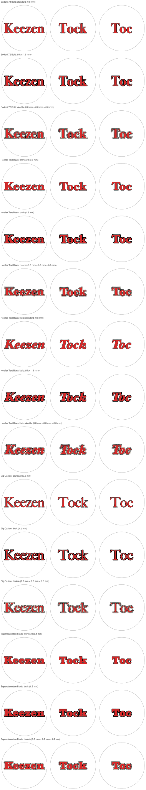
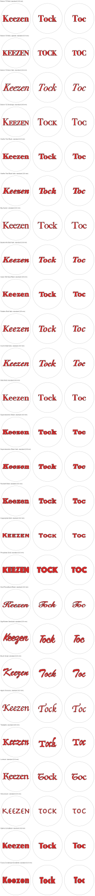

# Tock-Lid-Generator

A generator to create STLs for the lid of the Tock box.

It turns a word ("Keezen", "Tock", "Toc", …) into a round lid insert for multi-colour
printing: coloured letters, a black outline around every letter edge, and the rest of the disc.
Every colour comes out as its own STL (for the slicer) and its own SVG (for CAD), all sharing
one origin at the centre of the lid, so they fit together exactly.

## Fonts and styles

The three outline styles on a shortlist of fonts, each word sized to the 122 mm lid:



Every built-in font in the standard 0.8 mm outline (`tock-lid fonts` lists their keys):



Both images are generated; run `docs/generate.sh` after changing fonts or styles.

## Download

Every built-in font in all three styles (standard, thick, double) is available as
ready-to-slice STLs in one zip, attached to the
[latest release](https://github.com/AntondeGroot/Tock-Lid-Generator/releases/latest).
It is organised as `font/style/word/`, and each word folder has one STL per colour plus a preview.
To build the zip yourself: `.venv/bin/tock-lid bundle` (writes `out/tock-lids.zip`).

## Setup

Requires Python 3.11+ and macOS for the built-in fonts (any `.ttf`/`.otf` works with `--font-file`).

```sh
python3.13 -m venv .venv
.venv/bin/pip install -e '.[dev]'
```

## Usage

| Command | What it does |
|---|---|
| `.venv/bin/tock-lid fonts` | list the built-in fonts |
| `.venv/bin/tock-lid styles` | list the outline styles |
| `.venv/bin/tock-lid generate --font bodoni --style double` | SVG and STL files per word and colour, in `out/` |
| `.venv/bin/tock-lid overview --fonts bodoni hoefler-black --styles standard thick double` | one comparison sheet, `out/overview.svg` |
| `.venv/bin/tock-lid docs` | regenerate the README images |
| `.venv/bin/tock-lid bundle` | zip with the STLs of every font in every style, `out/tock-lids.zip` |

`generate` writes one folder per word into `out/`:

| File | What it is |
|---|---|
| `keezen-preview.svg` | all colours together, with the lid edge dashed |
| `keezen-fill.stl/.svg` | the letters |
| `keezen-outline.stl/.svg` | the black outline (`outline-inner`, `gap`, `outline-outer` for `double`) |
| `keezen-background.stl/.svg` | the rest of the disc |

In the slicer, load all STLs of one word at once and choose **one object with multiple parts**,
then give each part its filament.

Options shared by all commands that build lids:

| Option | Default | Meaning |
|---|---|---|
| `--words` | `Keezen Tock Toc` | one lid per word; all words get the same letter size |
| `--diameter` | `122` | diameter of the insert in mm |
| `--margin` | `5` | clearance between the text and the edge in mm |
| `--thickness` | `1.0` | height of the STL parts in mm |

## Printability

Every line is kept at least 0.4 mm wide, one nozzle width:

- thin strokes in a font are thickened by 0.2 mm on each side before the outline is added;
- sharp notches where two strokes of a letter meet are filled by the letter, so the outline
  never ends in a needle;
- pockets narrower than 0.4 mm between neighbouring letters are filled by the outline,
  so the next ring outward never gets slivers;
- specks of background left inside tiny letter holes are taken over by the outline;
- `generate` warns about any spot that is still thinner than 0.4 mm. Every built-in font
  in every style passes this check for "Keezen", "Tock" and "Toc".
